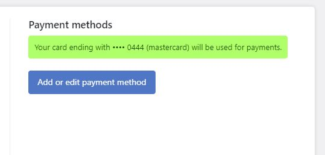

# Billing details

### Updating your billing details

To change your billing details, open [dashboard.super-forms.com](https://dashboard.super-forms.com) and sign in with your [Super Forms account](../../quick-start/registration.md#registering-a-new-account). Open **Manage Billing** (Quick Actions). This action shows after your first purchase. The page title is **Billing Details** — update your details there.

<figure><figcaption>
Updating your billing details.
</figcaption></figure>

### Updating your card details

To update an existing card or add a new one, open [dashboard.super-forms.com](https://dashboard.super-forms.com), sign in with your [Super Forms account](../../quick-start/registration.md#registering-a-new-account), and open **Payment Methods** (Quick Actions). Click **Add Card** (or **Add Your First Card** if you have none yet).

<figure><figcaption>
Adding a new or updating an existing payment method (card).
</figcaption></figure>

