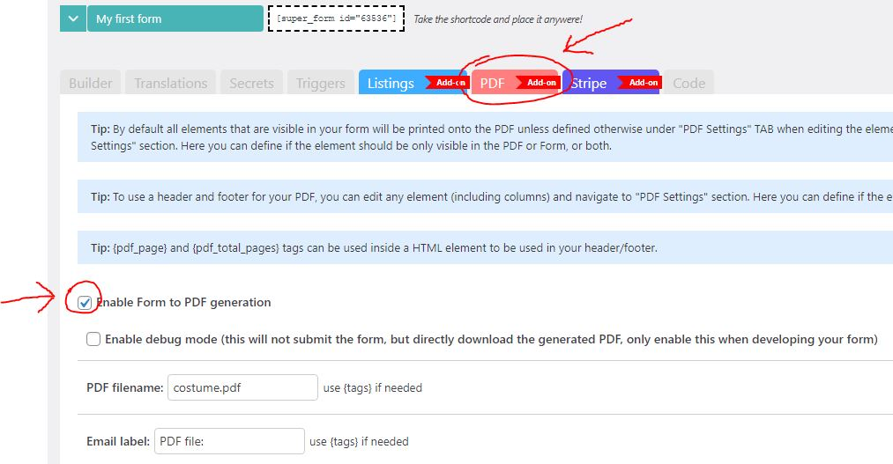

# PDF Generator

### About

This Add-on allows you to convert any form submission into a PDF file which would look identical to how the form was displayed on the front-end in the browser.

When a user submits the form, the PDF will be generated and optionally (if enabled) attached to the Admin and/or Confirmation E-mail.

The PDF file will also be attached to the Contact Entry (if enabled).

You also have the option to specifically include or exclude elements from the PDF, which should give you a ton of flexibility to choose from.

You can also define a Header and Footer element which would then be visible on all pages of the generated PDF file.

### How PDF generation works

The PDF is built in the visitor's browser, before the form is submitted. While this happens the visitor sees a popup with the text **Generating PDF file...** (you can change it with the **Generating text** setting) and a progress bar. Only after the PDF is finished is the form submitted: the Contact Entry is saved and the E-mails (with the PDF attached, if enabled) are sent.

Because the browser does all the work, generation takes longer and uses more memory when:

* the form has many elements or results in many pages;
* the **PDF render scale** is high;
* the form contains large images, or images loaded from another domain (cross-origin).


**Tip:** if generation is slow or fails on some devices, lower the **PDF render scale** (see [PDF Render scale](#pdf-render-scale-resolution-sharpness-quality)).


### Debug mode

Debug mode downloads the generated PDF directly in the browser so you can check the result while building your form. Only enable it while developing your form.

* **6.4 (beta):** **\[PDF]** TAB > **Enable Form to PDF generation** > **General settings** > **Enable debug mode**. The PDF is downloaded and the form is not submitted.
* **6.3 (LTS):** **\[PDF]** TAB > **Enable Form to PDF generation** > **Enable debug mode (this will not submit the form, but directly download the generated PDF, only enable this when developing your form)**.


**6.3 LTS:** in 6.3.322 and older, debug mode also submits the form (the entry is saved and e-mails are sent), so test with safe e-mail recipients.


### Quick start

Open [dashboard.super-forms.com](https://dashboard.super-forms.com) and sign in (WordPress **Super Forms > Licenses** opens the same dashboard). Click **Purchase New License**, add **PDF Generator** and complete the checkout. Your new license appears under **Unused License Codes**. Click **Activate License** and enter your WordPress domain. Then open any form under **Super Forms > Your forms**, or create one under **Super Forms > Create form**.


The dashboard trial is for Super Forms only. To save forms you need a Super Forms license or a Super Forms 15 day trial.


Now click on the **\[PDF]** TAB at the top of the builder page. Here you will find all the settings and options for the Add-on. To enable PDF generation you can simple check the option Enable Form to PDF generation.

<div align="left"><figure><figcaption><p>Enable form to PDF generation for your WordPress form.</p></figcaption></figure></div>

When the form is submitted a PDF file will be generated with all the form data.

### Include and exclude elements from the PDF

When [creating your form](../../quick-start/creating-a-form.md), you will [add some elements](../../quick-start/adding-form-elements.md) which by default are visible to the user unless defined otherwise. Any element that is visible to the user will also be visible in the generated PDF. However you can override this behavior be [editing any element](../../quick-start/editing-elements.md#editing-a-single-element) in your form and navigating to the **PDF Settings** section where you can choose between one of the following options:

* Show on Form and in PDF file (default)
* Only show on Form
* Only show in PDF file
* Use as PDF header
* Use as PDF footer

### Setting up a Header and Footer for your PDF file

In order to enable a header or footer for your PDF file, you must define which element in your form should act as such.


**Note:** your form can only have one element defined to act as the header, and only one to act as the footer.


When you require more elements to be placed in either one, you can simply use a [Column ](../../elements/layout-elements/column-grid.md)element and define it as your header or footer. Just put the elements that you require inside this column.

You can enable a header by [editing your element](../../quick-start/editing-elements.md#editing-a-single-element) and navigating to the **PDF Settings** section. There you can choose between **Use as PDF header** or **Use as PDF footer**.

#### Displaying pagination

Inside your header and footer you can use the tags **{pdf\_page}** and **{pdf\_total\_pages}** inside a HTML element to display the current page. For example, the below HTML:

```
Page {pdf_page} of {pdf_total_pages}
```

Would translate to:

```
Page 2 of 13
```

### Using a dynamic PDF filename

When the PDF file is saved or downloaded it will have a default name **form.pdf**.

You can change this under the PDF filename setting. This setting is compatible with the [Tags system](../advanced/tags-system.md) so that you can generate dynamic filenames based on user input data.

For instance, when you have a form with the fields named `first_name` and `last_name`, you can define your filename as follows:

```
{first_name}-{last_name}.pdf
```

Which could translate to:

```
John-Doe.pdf
```

### Attaching the generated PDF file to your E-mails

By default the PDF will be attached to the Admin and Confirmation E-mail, but you can disable this by unchecking the option **Attach generated PDF to admin e-mail** or **Attach generated PDF to confirmation e-mail**.

### Exclude the PDF from contact entry data

By default the PDF will be saved in the Contact Entry (if you enabled to save Contact Entries that is). You can disable this by checking **Do not save PDF in Contact Entry**.

### Show download PDF button

In some cases you might not send any E-mails and perhaps not even save a Contact Entry, but you might just want to download the PDF file that was generated. In that case you can display a \[Download PDF] button to the user after the form was submitted.

You can enable this by checking the Show download button to the user after PDF was generated setting. Optionally you can define the download button text e.g. "Download Summary" or "Download PDF file" (or anything that suits your use case). You can also define the text that should be displayed during the PDF generation itself e.g. "Generating PDF file..."

### Page orientation portrait and or landscape

By default the generated PDF file has it's orientation set to "Portrait", but for some use cases you might prefer the "Landscape" orientation.

You can change the orientation via the **Page orientation** setting.


**Tip:** you can also change the orientation of the next page with the [**PDF page break**](../../elements/html-elements/pdf-page-break.md) element which can be found under the [HTML Elements](../../elements/html-elements/) section.


### Unit of measure, page format and margins settings

There are several more settings which you can define, which are listed below:

* **Unit** `mm (default)`, `pt`, `cm`, `in`, `px`
* **Page format** `a3`, `a4 (default)`, `a5`, `letter`, `legal`, `Custom page format` etc.
* **Body margins** top/right/bottom/left
* **Header margins** top/right/bottom/left
* **Footer margins** top/right/bottom/left

### PDF Render scale (resolution/sharpness/quality)

This option allows you to fine tune the resolution of the generated PDF file. This setting should be left to the default value for best results, unless you require a higher resolution.


**Note:** you will lose "pixel" quality when lowering the render scale.


If your PDF file size is becoming to large you might want to consider lowering the render scale setting at a rate of **0.1** at a time during testing. When working with large forms it is important to check the PDF file size during development and to adjust the render scale accordingly if needed.

### Native PDF elements


This feature is currently only available in the [BETA version](../../developers/beta-version.md).


When you enable the PDF to generate native elements, it will not take a snapshot (image) of the form. Instead it will use native PDF elements which makes the render process quicker, and the PDF file size smaller.

In most cases you will want to enable this mode. This is now the preferred method. The downside is that it might not look 100% identical to how the form looks on the front-end. So you might want to try both methods, and see which one suits your use case best.

### Smart page breaks


This feature is currently only available in the [BETA version](../../developers/beta-version.md).


With smart page breaks enabled any element and or text will automatically be pushed onto the next page in case it didn't fit on the previous page for the full 100%.

### Troubleshooting: stuck at "Generating PDF file..."

In **6.3.323 LTS** and **6.4.010 Beta**, if a PDF cannot be created the form is restored and an error message with a **Close** button appears. Nothing is submitted, and the visitor can try again.

If the popup keeps showing **Generating PDF file...** (or your own **Generating text**) and the form is never submitted, work through these steps:

1. **Open the browser console** (press F12 and open the **Console** tab), submit the form again and look for red error lines. They usually point at the element or image that fails to render.
2. **Use [debug mode](#debug-mode)** to test the PDF without waiting for the full submission. On 6.3 LTS, keep in mind that debug mode in 6.3.322 and older still submits the form.
3. **Compare the settings** on the **\[PDF]** TAB and the **PDF Settings** section of your elements with a form where the PDF works.
4. **6.4 with a non-Latin language script:** open the **Network** tab of the browser developer tools and check whether the request for `fonts/<language>.json` failed. In 6.4.010 and later the PDF falls back to the default font when this file is missing, so non-Latin text may not display correctly. In 6.4.009 and older the PDF cannot start without it.
5. **If the popup moved on to "Processing form data..." and then showed an error**, the PDF was created but is too large for your server. Ask your host to raise `post_max_size`, `memory_limit` or `max_execution_time` in PHP, or lower the **PDF render scale**.
6. **Remove half of the form** (on a copy) and test again. Repeat with the half that still fails until you find the element that causes it.

### Pricing

<table><thead><tr><th width="152">Volume</th><th width="189">Price per license</th><th>Total</th></tr></thead><tbody><tr><td>1+</td><td>$5</td><td>1 license would cost $5 p/m</td></tr><tr><td>5+</td><td>$3</td><td>5 licenses would cost $15 p/m</td></tr><tr><td>10+</td><td>$2.5</td><td>10 licenses would cost $25 p/m</td></tr><tr><td>20+</td><td>$2</td><td>20 licenses would cost $40 p/m</td></tr><tr><td>40+</td><td>$1.5</td><td>40 licenses would cost $60 p/m</td></tr></tbody></table>
